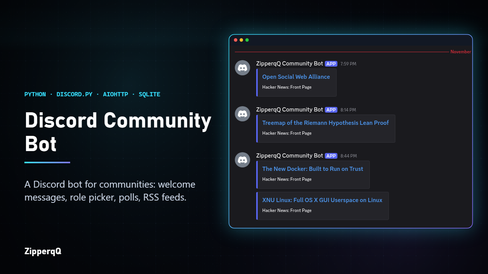
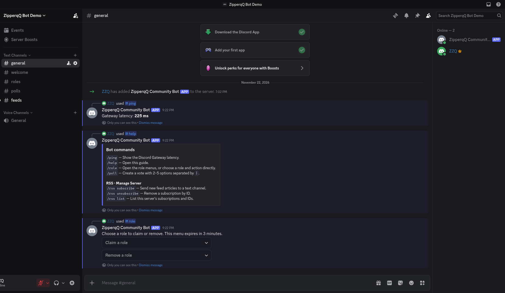
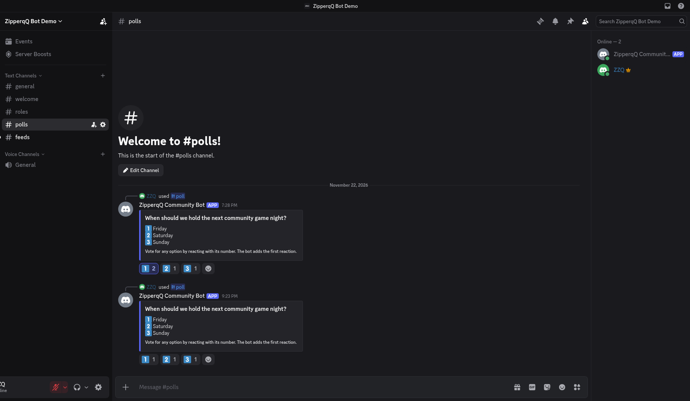
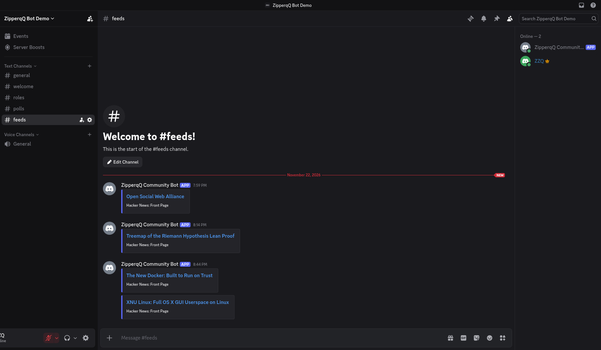

# Portfolio Discord Bot



A Python Discord bot for community onboarding, self-service roles, reaction polls, and RSS updates. It uses discord.py for slash commands and UI, aiohttp to fetch feeds, and SQLite for subscription history.

## Features

| Feature | How to use it |
| --- | --- |
| Welcome | Configure a text channel, title, and message. New members receive an embed with their avatar. |
| Self-service roles | Run `/role` to open private Claim and Remove menus. To skip the menu, choose a `role` and an `action`. The server owner controls the allowed role IDs. |
| Ping and help | Run `/ping` for Gateway round-trip latency or `/help` for the in-Discord command guide. |
| Polls | Run `/poll` with a question and 2–5 options separated by `\|`. Members can react to any number of options. Discord retains the reactions across bot restarts. |
| RSS | With **Manage Server**, use `/rss subscribe`, `/rss list`, and `/rss unsubscribe`. The bot posts links to new articles in the selected channel. |
| Logging | JSON records go to the console and a rotating file under `logs/`. |

## Screenshots


| `/role` menus | `/poll` | RSS auto-posts |
| --- | --- | --- |
|  |  |  |

## Tech stack

- **Python 3.12+** with [discord.py](https://github.com/Rapptz/discord.py) 2.6, aiohttp, and python-dotenv
- Slash commands and Discord UI components (role menus, reaction polls)
- SQLite for RSS subscriptions and delivery history
- Offline unit and integration tests (no Discord token or network required)

## Install

Python 3.12 is the supported version.

**Windows (PowerShell):**

```powershell
py -3.12 -m venv .venv
.\.venv\Scripts\python.exe -m pip install -r requirements.txt
Copy-Item .env.example .env
```

If the Windows Python launcher cannot find Python 3.12, run `python --version`, then use `python -m venv .venv` with that interpreter.

**macOS / Linux:**

```bash
python3 -m venv .venv
.venv/bin/python -m pip install -r requirements.txt
cp .env.example .env
```

## Create and invite the bot

1. Open the [Discord Developer Portal](https://discord.com/developers/applications) and select **New Application**. Give the app a name.
2. Open **Bot**. Choose **Reset Token** and copy the generated bot token to `DISCORD_TOKEN` in the local `.env` file. Keep that file private. If you already have the current token, you can use it without resetting it.
3. Under **Bot → Privileged Gateway Intents**, enable **Server Members Intent** if you will configure a welcome channel. The bot requests that intent when `welcome.channel_id` is set. Leave **Presence Intent** and **Message Content Intent** off.
4. Under **Installation**, enable **Guild Install**. Set the Guild Install scopes to `bot` and `applications.commands`. Grant **View Channels**, **Send Messages**, **Embed Links**, **Read Message History**, **Add Reactions**, and **Manage Roles**. Use the generated install link, or replace `YOUR_APPLICATION_ID` in this URL with the Application ID on the **General Information** page.

   ```text
   https://discord.com/oauth2/authorize?client_id=YOUR_APPLICATION_ID&scope=bot%20applications.commands&permissions=268520512&integration_type=0
   ```

5. Open the link, add the app to a server you manage, and authorize it. In **Server Settings → Roles**, move the bot's highest role above the interest roles it can assign. Use low-privilege interest roles for self-service. Check that channel overrides allow the bot to post in the welcome and RSS destination channels, and to seed reactions in poll channels.

See the [Discord app setup guide](https://docs.discord.com/developers/quick-start/getting-started) and the [Discord permission reference](https://docs.discord.com/developers/topics/permissions).

## Configure and run

Set `DISCORD_TOKEN` in `.env` or the process environment. The process environment takes precedence. Edit the following fields in `config.json` and restart the bot to apply changes. The file in this repository ships with `null` / empty IDs so you can fill in your own server, channel, and role IDs. It does not contain a bot token.

| Setting | Behavior |
| --- | --- |
| `sync_guild_id` | Set to your demo server ID for server-only command registration. The default `null` registers commands globally. |
| `welcome.channel_id` | Text or announcement channel ID. The default `null` turns welcome messages off. |
| `welcome.title`, `welcome.message` | Embed templates. Use `{server}` for the server name, `{member}` for the display name, and `{mention}` for a mention rendered in the embed. Use `{{` and `}}` for literal braces. |
| `self_assignable_role_ids` | Up to 25 unique role IDs. Both the slash command and the menus check the allowlist and the bot's role hierarchy. |
| `rss.interval_seconds` | Polling interval in seconds. Defaults to 300 and supports 30 through 86,400. |
| `rss.database_path` | Project-relative SQLite file path. Defaults to `data/subscriptions.sqlite3`. |
| `logging` | Log level, project-relative file path, rollover size in bytes, and number of backups. |

Enable **Developer Mode** in Discord under **User Settings → Advanced**, then right-click a server, channel, or role and copy its ID. Put IDs in JSON as quoted decimal strings.

```powershell
.\.venv\Scripts\python.exe -m portfolio_bot
```

```bash
.venv/bin/python -m portfolio_bot
```

The `commands_synced` and `discord_ready` log entries confirm registration and connection. Try `/help` in your demo server. Keep one bot process running per SQLite database. Stop it with `Ctrl+C`. On Windows, `start_bot.cmd` starts the bot with the same settings.

### HTTP(S) proxy

On networks that cannot reach Discord or RSS hosts directly, configure a proxy for Discord REST, the Gateway, and RSS. For example, set `PROXY_URL=http://127.0.0.1:7897` in `.env` or the process environment and restart the bot. The bot loads `.env` when `DISCORD_TOKEN` is absent or empty in the process environment. If you supply the token through the process environment, supply the proxy there too.

The bot uses the first nonblank value in the order `PROXY_URL`, then `HTTPS_PROXY`. With both unset or blank, the bot connects directly.

### RSS example

Choose `/rss subscribe`, paste `https://blog.python.org/rss.xml` into `url`, and select a destination such as `#dev-news`. This public feed needs no API key. [Python Insider feed announcement](https://blog.python.org/2026/03/the-python-insider-blog-has-moved/)

The bot records the feed's current articles at subscription time and posts entries first seen on subsequent polls. Use `/rss list` to find the subscription ID and `/rss unsubscribe subscription_id:<id>` to remove it. The same feed can be subscribed to in multiple channels. Each destination maintains its own delivery history.

The fetcher accepts RSS 2.0, RSS 1.0, and Atom from public HTTP(S) hosts on standard ports. Missing titles receive a fallback and entries without a usable article link are skipped. It deduplicates by publisher ID or article URL, checks public DNS results at each redirect, and limits response size and request time. In proxy mode the bot checks destination DNS locally before forwarding, and the proxy controls DNS resolution for the outbound connection. Failed deliveries are retried while the article remains in the feed. Delivery history is saved after Discord accepts each message. An interruption between those steps can cause the same message to be sent again.

## Tests

```powershell
.\.venv\Scripts\python.exe -m unittest discover -s tests -v
```

```bash
.venv/bin/python -m unittest discover -s tests -v
```

Tests use local RSS and Atom XML fixtures, temporary SQLite files, and mocked Discord and feed I/O. The suite needs no Discord token, account, or network connection. With dependencies installed, the suite also exercises the discord.py command tree, welcome embeds, role menus, reaction polls, and the full subscription-to-delivery flow. If discord.py is missing, the integration module is reported as skipped and the standard-library tests still run.

## Layout

```text
portfolio_bot/
  __main__.py       Environment and process entry point
  bot.py            Discord lifecycle and background worker
  community.py      Welcome, roles, ping, help, and polls
  rss_commands.py   Slash commands for managing feeds
  rss_http.py       HTTP client and public DNS resolution
  feeds.py          RSS and Atom parsing and URL validation
  rss_service.py    Polling and article delivery orchestration
  subscriptions.py  SQLite subscriptions and delivery history
  config.py         Validated JSON configuration
  proxy.py          Shared HTTP(S) proxy configuration
  logging_setup.py  Structured console and rotating file logs
tests/              Offline tests and XML fixtures
docs/screenshots/   Demo screenshots
config.json         Non-secret settings (no token; fill in your server IDs)
.env.example        Environment template
requirements.txt    Pinned Python dependencies
```

## License

[MIT](LICENSE)
